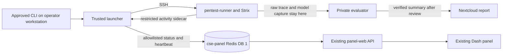

# Pentest lab live panel — implementation plan

Status, 19 October 2026: **all three increments deployed and verified live**
on `task/pentest-live-panel-plan` -- the read-only sanitized feed, browser-
launchable runs (no CLI required to start one; `pentest_tasks.py` +
`fixture_control.py` + panel job-submission API/UI), and the native-detail
live viewer (no CLI required to watch one in full detail; `viewer_proxy.py`
+ the panel's viewer-proxy routes), reverse-proxied through the panel with
no terminal access needed anywhere in the chain.

A real I01 job was submitted through `POST /pentest/api/jobs` (not the CLI),
ran to completion via the new `pentest-worker` Celery worker on
`cse-controller`, and its native Strix viewer was activated and fetched
through the full two-hop proxy chain (`cse-panel-stack` → `cse-controller` →
SSH tunnel → `pentest-runner`) -- confirmed the session cookie, the
authenticated `/api/run` call, and the real executive summary (matching the
independently-verified marker `d510b421f8167d1d`) all came back correctly
through the browser-equivalent path. Deactivation was confirmed to leave no
native process or PID file on `pentest-runner`.

Getting there live surfaced and fixed eight real bugs that no amount of unit
testing alone would have caught, each the kind this project's own discipline
exists to catch rather than paper over: a missing inventory file (two
checkouts, non-secret, safe to copy across), a venv created on the host
instead of inside the container (wrong Python namespace entirely), two
missing environment variables the worker crashed on its very first real job
without, a redeploy that updated code on disk but never restarted the
process using it, `viewer_proxy.py` holding an SSH key path it never
actually passed anywhere, a header-duplication cleanup that was real but
not the actual cause of a missing session cookie, and -- the actual
cause -- `_forward()` silently dropping the query string, so the token that
makes the whole native-viewer auth flow work never reached the backend at
all. See `plan.md`'s own closeout convention; each fix has its own commit
with the live evidence that found it, not just the patch.

Remaining blockers before this stays load-bearing long-term: the same new
dedicated SSH identity question (now resolved -- a plain key, forced-command
hardening tracked as follow-up, not blocking) and a new
narrow MikroTik rule for the viewer proxy specifically (see below) -- none
of it has been applied to `cse-controller`/`cse-panel-stack` yet.

## Native-detail live viewer (CLI-free, full transcript)

The sanitized feed above answers "is it running and what's the shape of its
activity" without ever showing raw commands/output. It deliberately does not
answer "what exactly is it doing" -- that was judged not enough once the
operator needs this usable from anywhere, including through Pangolin, with
no terminal access at all. Strix 1.7.0 already ships a full native browser
viewer (`strix view`) reading `run.json`/`.state/agents.db` directly -- the
same one `launcher/view_run.py` already wraps in an SSH tunnel for a
terminal session. The gap was that `view_run.py` requires a terminal on the
same machine as the browser; it cannot be reached through the panel.

Investigated live, not assumed, before building anything: fetched the
viewer's actual served HTML and JS bundle through a real tunnel.
Asset references are relative (`./assets/...`), so the SPA works fine when
served from a sub-path. Its own API calls (`/api/run`, `/api/transcript`,
etc.) are **absolute from root**, so they cannot be nested under
`/pentest/api/`; they need a separate, unprefixed route at the panel's own
origin root. Auth is a plain `HttpOnly` session cookie set once when the
browser loads `/?token=...` -- not a per-request token -- confirmed by
testing a real running instance (visiting with the token, then confirming a
cookie-jar-only follow-up request to `/api/run` succeeds). No WebSocket or
SSE anywhere in the bundle -- plain HTTP polling, so a transparent HTTP
reverse proxy is sufficient; nothing needs upgrade handling.

Built, matching that investigation exactly:

- `cse-controller/pentest-worker-config/viewer_proxy.py` -- a persistent,
  single-slot reverse proxy (one active tunnel at a time, matching "only me
  uses this"). `POST /control/activate {run_id, native_run_name}` starts
  (or reuses) the tunnel and returns its token; `POST /control/deactivate`
  tears it down; everything under `/proxy/*` is forwarded transparently,
  header-for-header, including `Set-Cookie`/`Cookie` -- no token handling
  of its own. Reuses `view_run.py`'s exact SSH-tunnel/cleanup functions
  rather than a second copy. An idle-timeout reaper and a SIGTERM handler
  both tear the tunnel down the same verified way view_run.py's own fix
  does (see that fix's commit for why SIGTERM needed its own handler). 16
  tests, including real HTTP passthrough against a fake backend server
  (not just mocks).
- `run_task.py`/`activity_status.py`: the launcher now resolves and
  publishes the run's **native** Strix run name (e.g.
  `192-168-70-213-8080_2e8c`) during the run -- needed because Strix
  generates that name itself and never records our own `run_id` anywhere
  recoverable. Without this, the viewer could only ever guess "newest run",
  not look up the specific one the operator picked.
- `cse-panel-stack/app/pentest.py`: `POST /pentest/api/runs/{id}/viewer`
  (looks up the native run name, calls the proxy's `/control/activate`,
  hands back a `viewer_url`) and `.../viewer/stop`; plus a second,
  deliberately **unprefixed** router (`viewer_proxy_router`, mounted
  separately in `app.py`) for `/pentest/viewer/*` (the SPA itself) and bare
  `/api/*` (its absolute API calls) -- both forwarded to the cse-controller
  proxy via `asyncio.to_thread` so the event loop isn't blocked. Nothing
  else on this app may ever claim bare `/api/*`.
- `pentest_tab.py`: a "View live detail" button, shown only once a run's
  native name is known, that activates the viewer and opens it in a new
  tab via a small clientside callback (`window.open`).

**New trust path this specifically requires**, beyond the SSH identity
already called out elsewhere in this document: `viewer_proxy.py` must bind
to `cse-controller`'s own address, not loopback -- the one deliberate
exception to this project's loopback-only philosophy, because
`cse-panel-stack` (`mgmt_seg`) has to reach it. That needs its own new,
narrow MikroTik rule (`cse-panel-stack` → `cse-controller`, one port only).
Neither this rule nor the SSH identity exist yet; see
`cse-controller/STACK_CONTRACT.md`'s own note on this.

## Operator outcome

Add a **Pentest lab** tab to the existing Authentik-protected Benchmark Control
Panel at `cse-panel.<domain>`. During an approved run it should show the task,
run ID, loaded model, elapsed time, current phase, last heartbeat, Framework
holder, model request/response counts, tool-call count, errors, cleanup state,
and a timestamped activity timeline. The timeline must show when a model call
starts/ends, which allowed tool was invoked, when it returns, and safe
target-request summaries (for example `GET /info` or `GET /notes/2`). It must
also show lock, launch and cleanup transitions, plus fixture-reset attestation
when the trusted reset helper supplies one; otherwise it must say `reset not
attested in live feed`. Refresh within five
seconds of a new activity event. After a run, show
the launcher's completion class and, only when separately verified, the
verifier's verdict and Nextcloud report link. `completed` is never displayed
as a security pass.

The first increment retains `run_task.py` as the controller on the operator's
existing workstation. A web page never receives runner SSH credentials,
OpenBao values, fixture keys, raw model traffic, tool arguments, tool output,
prompts, or unfiltered Strix logs. This is an action timeline, not a live
reasoning transcript: model thought text and generated payloads remain private.

## Existing pattern to reuse

| Concern | Existing implementation | Pentest adaptation |
|---|---|---|
| Browser | `cse-panel-stack/app-ui/app.py` is a Dash panel with CyberSecEval, Eval battery and Compare tabs; `dcc.Interval` polls at 4–10 seconds. | Add a Pentest lab tab polling every 2–4 seconds. Use the same table/detail, local-time, Framework header and API-access patterns. |
| API | `cse-panel-stack/app/app.py` is FastAPI. Eval battery's `/eval/api/state` reads bounded job state from Redis. | Add read-only `/pentest/api/state` and `/pentest/api/runs/{run_id}` with fixed response schemas. |
| State | CyberSecEval and eval-runner publish namespaced job state into cse-panel Redis; the panel does not execute benchmark code. | The trusted controller publishes a sanitized, short-lived projection under `pentest:*` keys. The launcher manifest and private traces remain authoritative. |
| Execution | Benchmark workers own execution; the panel only submits and observes. | Keep launch, fixture reset and verification in the trusted controller. Do not run Strix or read keys in panel-web/panel-ui. |
| Ingress | The existing panel and API routes use Traefik with Authentik forward-auth. | Reuse these routes; add no public runner endpoint or cross-zone inbound rule. |
| Results | Nextcloud is the durable report store. | Link only independently verified and separately published reports. Redis is a live cache, not a verdict store. |

## Prerequisite: make the Framework lock truly shared

`framework_lock_client.RedisRESPClient` currently authenticates and uses the
default Redis DB 0. CyberSecEval and eval-runner use Celery result-backend DB 1
(`CELERY_RESULT_BACKEND=.../1`), and the panel reads their
`framework:run-lock` from DB 1. Identical key names in different databases do
not coordinate those runs. Fix the pentest client to select DB 1 explicitly;
test its RESP parsing and prove cross-worker contention in a controlled test.
Do not infer exclusivity from the 18-run baseline: Framework was separately
reserved for that batch. A live lock validation needs its own production
preflight and approval before any new assessment.

## Live data path



Keep the existing exact recorder capture under `/root/model-traffic/` mode
0600. The implementation uses a runner-local read-only projector instead of
the originally proposed second sidecar: it reads new recorder events and
Strix trace rows, then returns only allowlisted metadata over the existing
controller SSH path. This avoids a duplicate on-disk event stream. It never
copies request/response bodies, tool arguments or outputs to Redis. The
controller validates the projection again and writes a bounded status record.
It also emits launcher
phase transitions and a heartbeat independently of model responses, so a long
generation is visible as active rather than silent. A sidecar/panel failure
marks observability stale; it must not change lock ownership, cleanup or the
independent security verdict.

The first increment must also include a safe tool timeline. Discover how the
installed Strix 1.7.0 writes live tool-call and tool-result rows to
`.state/agents.db`; build a read-only projector on the runner that emits
timestamp, a fixed allowlisted tool name, start/finish state, duration and
exit/status class. For recognized simple `curl` calls to the exact fixture
host, a strict parser may add HTTP method and an allowlisted path **without**
query, headers or body. For any command it cannot parse safely, show
`shell action (details hidden)` rather than the command. Use stable event IDs
to deduplicate polls and cap the timeline retained in Redis. If the native
trace is not readable until run end, add a restricted runner-side event hook
instead; do not declare the live view complete with only request counters.
Do not render commands, headers, paths with query strings, output or free-form
model text, and do not scrape the unfiltered launcher log into Redis (the eval
battery's `log_tail` pattern is unsafe for this lab).

The run detail should read like this, with fixture-generated values omitted:

```text
09:41:02  Framework lock acquired; I01 started
09:41:08  Model request 1 started
09:41:35  Model request 1 completed; one tool call
09:41:36  exec_command started: GET /info on authorized fixture
09:41:37  exec_command finished: exit 0 (response content hidden)
09:41:38  Model request 2 started
09:42:11  Strix exited; runner cleanup and lock release verified
09:43:05  Verifier verdict: pass (published report link)
```

The UI should label the last heartbeat age and show `activity feed delayed`
if the tool projection stalls while the launcher is still running. It must
never infer a tool result or task success from a model response alone.
The current `run_task.py` does not perform the fixture reset, so the panel
cannot assert that it occurred merely because a run started. Add an optional
event from the trusted reset/batch helper when that helper is used; otherwise
show the reset as unattested until the verifier records it.

Use Redis DB 1 keys such as `pentest:run:<id>` and
`pentest:recent-runs`, separate from Celery's keys and the shared Framework
lock. Keep the latest 50 IDs and expire live records after seven days;
published reports remain in Nextcloud. The API returns a stale flag when the
heartbeat is older than 20 seconds and an explicit `unavailable` state if
Redis cannot be read. It must not turn stale or missing data into `finished`.
At process exit, publish the manifest's classified completion and verified
remote cleanup/lock-release fields. Publication and verifier verdict arrive
only through an explicit, separate trusted update after scoring.

## Work sequence and acceptance checks

1. **Lock correction.** Update `launcher/framework_lock_client.py` to select
   DB 1 and add a focused test that a lock held by a benchmark-style Redis
   client blocks the pentest launcher, and vice versa. Keep the existing
   lost-lock and orphan-process tests passing. Validate against the live
   shared lock only with a task-specific production preflight.
2. **Sanitized events and tool timeline.** Add a small allowlist schema and bounded status
   publisher beside `launcher/run_task.py`; extend the recorder events with
   the request path needed to distinguish chat traffic, and add a read-only
   native-trace projector. Test that
   malicious strings in request bodies,
   response bodies, headers, prompts and tool output never appear in Redis
   payloads or API responses. Test strict fixture URL parsing, unknown
   commands, duplicate events, partial/error responses, long generations,
   recorder death, stale heartbeat, restart, and final cleanup. Preserve raw
   captures and their permissions.
3. **Read-only API and tab.** Add a `pentest` FastAPI router under
   `cse-panel-stack/app/` and a Dash module under `app-ui/`; register them in
   the existing apps. No new stack, route, network opening or secret. Show
   the loaded Framework model/holder using the existing header. Unit-test
   sorting, state labels, UTC-to-browser time conversion, stale state,
   unavailable API, and the distinction between launcher completion and
   verifier verdict. Run existing CyberSecEval and Eval battery panel tests.
4. **Local replay.** Feed synthetic model and tool events and sanitized copies of
   completed manifests to the local API/UI. Confirm the tab updates within
   five seconds, shows a coherent tool start/result sequence, survives a
   reload, and renders no private value. Do not use
   the real private keys or raw captures in UI fixtures.
5. **Approved live validation.** Before deploying to `pve-tiny`, provide
   `AGENTS.md`'s task-specific preflight: resolved hosts, exact deployment and
   smoke commands, changed objects, checks, out-of-scope actions, rollback.
   Run the affected Python tests and Ansible syntax checks locally, then
   deploy affected `pentest-runner` and `cse-panel-stack` playbooks under the
   production wrapper and approval. Check CyberSecEval/Eval tabs, Framework
   lock visibility, Authentik route and API. Run one new, separately approved
   fixture-only I01 attempt and independently verify its trace/key, actual
   `exec_command` start/result timeline, stale and terminal UI states,
   process/container cleanup and Redis lock release. If the browser shows
   only a spinner or model-call counters during this run, the live-view
   acceptance check has failed.
   Roll back the two stack deployments to their pinned prior revisions if
   their targeted checks fail; do not alter the fixture or erase evidence as
   part of a panel rollback.

## Browser launch, after the monitoring increment

The panel can first create a **draft run request** using an allowlisted task
catalogue (`I01`, `N01`, `W01`–`W04`) and fixed fixture target; it must reject
arbitrary URLs, shell commands, prompts and network ranges. A trusted
controller process on the operator workstation can consume only requests that
the operator has explicitly armed after the required chat preflight/approval,
using a one-run approval ID and `TASK_APPROVAL`. The browser cannot set that
environment variable or authorize itself. The controller rechecks fixture
mode/reset/key isolation, Framework identity and lock, runner preflight, scope
and budgets before launching. Verification and Nextcloud publication remain
separate steps with separate approval for production writes. Decide whether an
always-on controller is desirable only after the read-only panel is validated;
do not move production credentials into cse-panel-stack for convenience.

This second increment needs its own threat review, duplicate-submit and
idempotency tests, cancellation/cleanup tests, and production preflight. A
browser request does not automatically reset the fixture, start Strix, publish
a report or change a model.

### Alternative increment-2 shape considered: a dedicated `cse-controller` worker

An earlier, now-retired design (`task/autonomous-pentest-design`'s
`control-panel-plan.md`) proposed moving execution itself off the operator's
own workstation and onto a dedicated Celery worker on `cse-controller`,
reusing the same orchestration library as the command line. That design is
not adopted — the paragraph above keeps the trusted controller on the
operator's workstation, consistent with this project's whole history — but
its component-level detail is worth keeping as reference for whichever
increment-2 shape is eventually built, since it is more concrete than this
document's own sketch:

- **API contract**: `app/pentest_lab.py`, mounted beside `app/pentest.py`:
  `GET /pentest/api/state`, `POST /pentest/api/jobs`,
  `GET /pentest/api/jobs/{id}`, `POST /pentest/api/jobs/{id}/cancel`,
  `POST /pentest/api/jobs/{id}/publish`, `DELETE /pentest/api/jobs/{id}`
  (after terminal state and evidence-retention checks). Fixed task/mode
  enums, server-side validation, bounded Redis-backed job documents; secrets,
  raw model bodies and complete answer keys never enter Redis.
- **Worker shape**: concurrency-one run queue plus a separate control queue
  on `cse-controller`, reusing the existing late-acknowledgement/visibility-
  timeout/framework-lock/capped-state patterns. Steps: validate the fixed
  task, check no prior Strix/recorder/sandbox activity remains, acquire the
  shared Framework lock, reset the fixture and privately retain the new
  answer key, invoke the same trusted launcher the CLI uses, follow/normalize
  the live trace, confirm cleanup before releasing the lock, verify against
  the retained key, then publish.
- **Required new trust paths, none of which exist today**: (1) a dedicated
  `cse-controller`-to-`pentest-runner` identity for the fixed launcher/trace
  operations, not a fleet-wide key; (2) one new, narrowly scoped MikroTik
  allow from `cse-controller` to `pentest-fixture` for reset/mode/health/
  verification reads, with its own restricted fixture identity; (3) Redis
  credentials stay on `cse-controller` only — `pentest-runner` must not gain
  a path to management Redis. Before any of this is built: confirm whether
  an SSH forced-command account can cover all fixture operations and prefer
  that over general root SSH — this question was never answered and should
  not be skipped if this shape is picked up later.

Whichever increment-2 shape is actually built, it must keep the same
discipline as increment 1: the browser never receives SSH credentials, a
fixture key, or raw model traffic, and launcher completion, Strix's own
conclusion, and the independent verifier verdict stay three separate fields.

## Out of scope for the first increment

Model switching, arbitrary target selection, raw transcript streaming,
automatic scoring from Strix's summary, automatic publication, broad access to
runner/fixture management networks, new guests, and changes to the other
benchmark workers beyond testing shared-lock interoperability.
