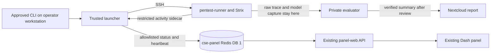

# Pentest lab live panel — implementation plan

Status: ready for implementation planning review, 18 October 2026. This is a
design and file-level work plan; no panel or launcher deployment is authorized
by this document. The first increment observes operator-launched runs. Browser
submission is a later, separately gated increment.

## Operator outcome

Add a **Pentest lab** tab to the existing Authentik-protected Benchmark Control
Panel at `cse-panel.<domain>`. During an approved run it should show the task,
run ID, loaded model, elapsed time, current phase, last heartbeat, Framework
holder, model request/response counts, tool-call count, errors, and cleanup
state. Refresh within five seconds of a new activity event. After a run, show
the launcher's completion class and, only when separately verified, the
verifier's verdict and Nextcloud report link. `completed` is never displayed
as a security pass.

The first increment retains `run_task.py` as the controller on the operator's
existing workstation. A web page never receives runner SSH credentials,
OpenBao values, fixture keys, raw model traffic, tool arguments, tool output,
prompts, or unfiltered Strix logs.

## Existing pattern to reuse

| Concern | Existing implementation | Pentest adaptation |
|---|---|---|
| Browser | `cse-panel-stack/app-ui/app.py` is a Dash panel with CyberSecEval, Eval battery and Compare tabs; `dcc.Interval` polls at 4–10 seconds. | Add a Pentest lab tab polling every 2–4 seconds. Use the same table/detail, local-time, Framework header and API-access patterns. |
| API | `cse-panel-stack/app/app.py` is FastAPI. Eval battery's `/eval/api/state` reads bounded job state from Redis. | Add read-only `/pentest/api/state` and `/pentest/api/runs/{run_id}` with fixed response schemas. |
| State | CyberSecEval and eval-runner publish namespaced job state into cse-panel Redis; the panel does not execute benchmark code. | The trusted controller publishes a sanitized, short-lived projection under `pentest:*` keys. The launcher manifest and private traces remain authoritative. |
| Execution | Benchmark workers own execution; the panel only submits and observes. | Keep launch, fixture reset and verification in the trusted controller. Do not run Strix or read keys in panel-web/panel-ui. |
| Ingress | The existing panel and API routes use Traefik with Authentik forward-auth. | Reuse these routes; add no public runner endpoint or cross-zone inbound rule. |
| Results | Nextcloud is the durable report store. | Link only independently verified and separately published reports. Redis is a live cache, not a verdict store. |

## Prerequisite: make the Framework lock truly shared

`framework_lock_client.RedisRESPClient` currently authenticates and uses the
default Redis DB 0. CyberSecEval and eval-runner use Celery result-backend DB 1
(`CELERY_RESULT_BACKEND=.../1`), and the panel reads their
`framework:run-lock` from DB 1. Identical key names in different databases do
not coordinate those runs. Fix the pentest client to select DB 1 explicitly;
test its RESP parsing and prove cross-worker contention in a controlled test.
Do not infer exclusivity from the 18-run baseline: Framework was separately
reserved for that batch. A live lock validation needs its own production
preflight and approval before any new assessment.

## Live data path

Keep the existing exact recorder capture under `/root/model-traffic/` mode
0600. Add a separate mode-0600 activity sidecar on the runner, emitted as each
request starts and completes. It contains only event type, timestamp, run and
request IDs, status/error *class*, elapsed time, model alias/build fingerprint,
usage counts when supplied, and counts of tool calls. Never copy a request or
response body into it. The controller incrementally polls this sidecar over
its existing runner SSH path while Strix is active, validates event schema and
run ID, and writes a bounded status record to Redis. It also emits launcher
phase transitions and a heartbeat independently of model responses, so a long
generation is visible as active rather than silent. A sidecar/panel failure
marks observability stale; it must not change lock ownership, cleanup or the
independent security verdict.

Start with counts and phase metadata. A later tool-activity view may show
allowlisted tool **names** read from a validated native trace projection;
do not render commands, HTTP headers, paths with query strings, outputs or
free-form model text. Discover the installed Strix 1.7.0 trace schema using
restricted test fixtures before adding that projection. Do not scrape the
unfiltered launcher log into Redis (the eval battery's `log_tail` pattern is
unsafe for this lab).

Use Redis DB 1 keys such as `pentest:run:<id>` and
`pentest:recent-runs`, separate from Celery's keys and the shared Framework
lock. Keep the latest 50 IDs and expire live records after seven days;
published reports remain in Nextcloud. The API returns a stale flag when the
heartbeat is older than 20 seconds and an explicit `unavailable` state if
Redis cannot be read. It must not turn stale or missing data into `finished`.
At process exit, publish the manifest's classified completion and verified
remote cleanup/lock-release fields. Publication and verifier verdict arrive
only through an explicit, separate trusted update after scoring.

## Work sequence and acceptance checks

1. **Lock correction.** Update `launcher/framework_lock_client.py` to select
   DB 1 and add a focused test that a lock held by a benchmark-style Redis
   client blocks the pentest launcher, and vice versa. Keep the existing
   lost-lock and orphan-process tests passing. Validate against the live
   shared lock only with a task-specific production preflight.
2. **Sanitized events.** Add a small allowlist schema and bounded status
   publisher beside `launcher/run_task.py`; add an opt-in metadata sidecar to
   `model_traffic_recorder.py`. Test that malicious strings in request bodies,
   response bodies, headers, prompts and tool output never appear in Redis
   payloads or API responses. Test partial/error responses, long generations,
   recorder death, stale heartbeat, restart, and final cleanup. Preserve raw
   captures and their permissions.
3. **Read-only API and tab.** Add a `pentest` FastAPI router under
   `cse-panel-stack/app/` and a Dash module under `app-ui/`; register them in
   the existing apps. No new stack, route, network opening or secret. Show
   the loaded Framework model/holder using the existing header. Unit-test
   sorting, state labels, UTC-to-browser time conversion, stale state,
   unavailable API, and the distinction between launcher completion and
   verifier verdict. Run existing CyberSecEval and Eval battery panel tests.
4. **Local replay.** Feed synthetic activity events and sanitized copies of
   completed manifests to the local API/UI. Confirm the tab updates within
   five seconds, survives a reload, and renders no private value. Do not use
   the real private keys or raw captures in UI fixtures.
5. **Approved live validation.** Before deploying to `pve-tiny`, provide
   `AGENTS.md`'s task-specific preflight: resolved hosts, exact deployment and
   smoke commands, changed objects, checks, out-of-scope actions, rollback.
   Run the affected Python tests and Ansible syntax checks locally, then
   deploy affected `pentest-runner` and `cse-panel-stack` playbooks under the
   production wrapper and approval. Check CyberSecEval/Eval tabs, Framework
   lock visibility, Authentik route and API. Run one new, separately approved
   fixture-only I01 attempt and independently verify its trace/key, stale and
   terminal UI states, process/container cleanup and Redis lock release.
   Roll back the two stack deployments to their pinned prior revisions if
   their targeted checks fail; do not alter the fixture or erase evidence as
   part of a panel rollback.

## Browser launch, after the monitoring increment

The panel can first create a **draft run request** using an allowlisted task
catalogue (`I01`, `N01`, `W01`–`W04`) and fixed fixture target; it must reject
arbitrary URLs, shell commands, prompts and network ranges. A trusted
controller process on the operator workstation can consume only requests that
the operator has explicitly armed after the required chat preflight/approval,
using a one-run approval ID and `TASK_APPROVAL`. The browser cannot set that
environment variable or authorize itself. The controller rechecks fixture
mode/reset/key isolation, Framework identity and lock, runner preflight, scope
and budgets before launching. Verification and Nextcloud publication remain
separate steps with separate approval for production writes. Decide whether an
always-on controller is desirable only after the read-only panel is validated;
do not move production credentials into cse-panel-stack for convenience.

This second increment needs its own threat review, duplicate-submit and
idempotency tests, cancellation/cleanup tests, and production preflight. A
browser request does not automatically reset the fixture, start Strix, publish
a report or change a model.

## Out of scope for the first increment

Model switching, arbitrary target selection, raw transcript streaming,
automatic scoring from Strix's summary, automatic publication, broad access to
runner/fixture management networks, new guests, and changes to the other
benchmark workers beyond testing shared-lock interoperability.
